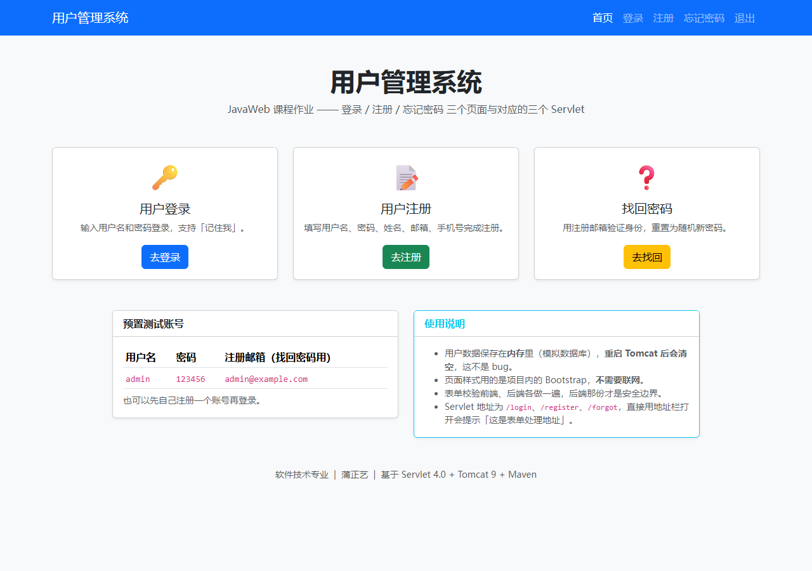
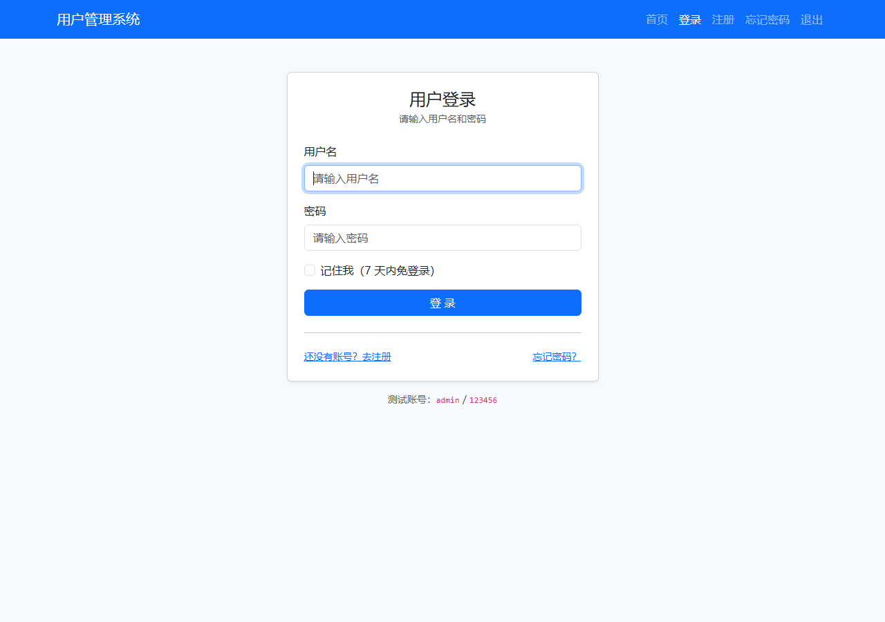
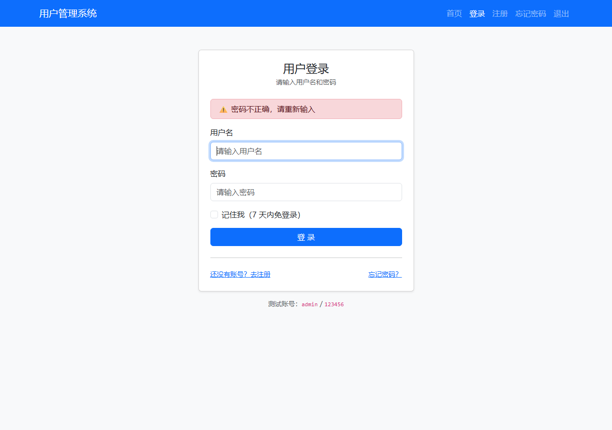
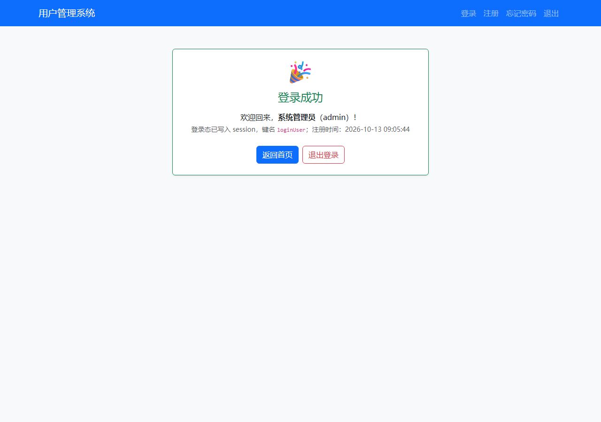
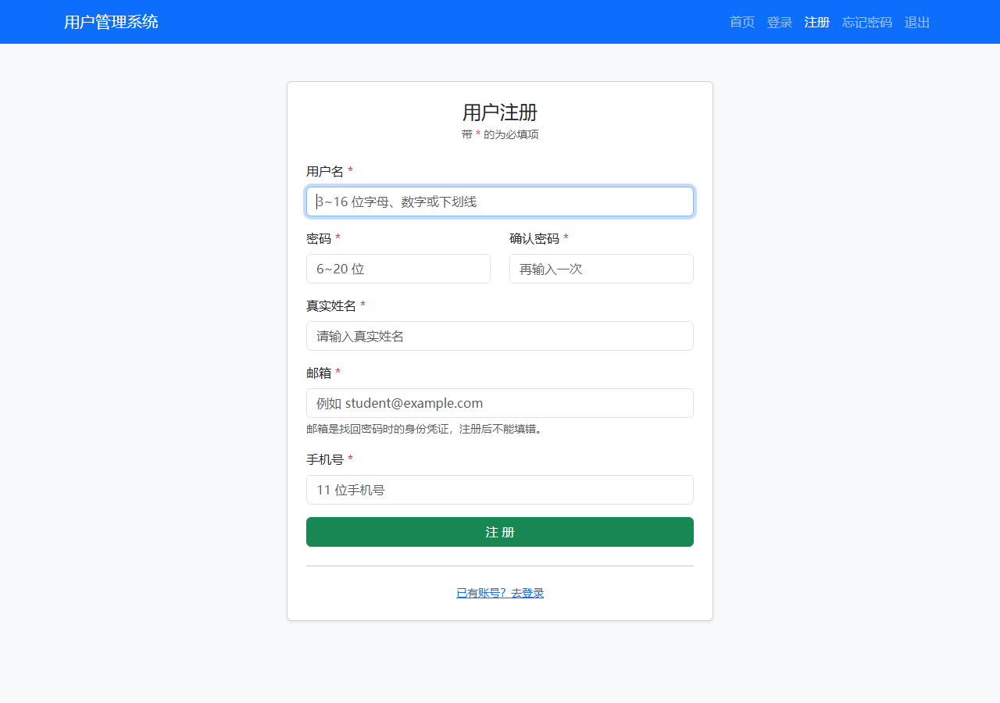
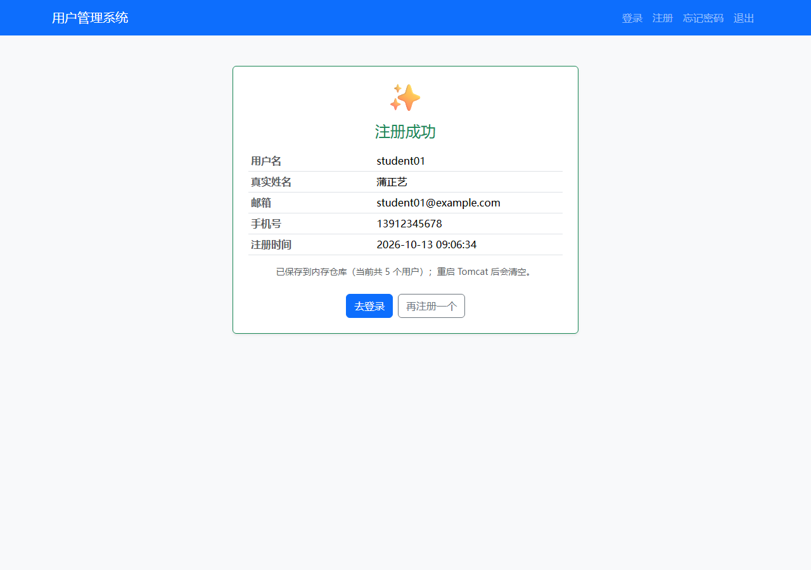
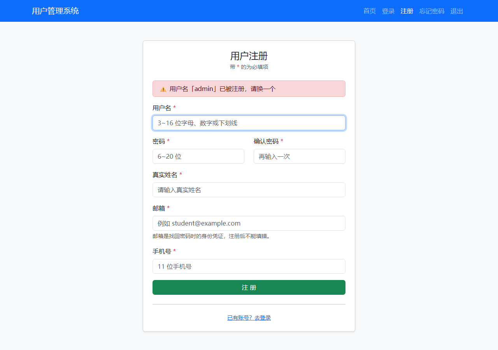
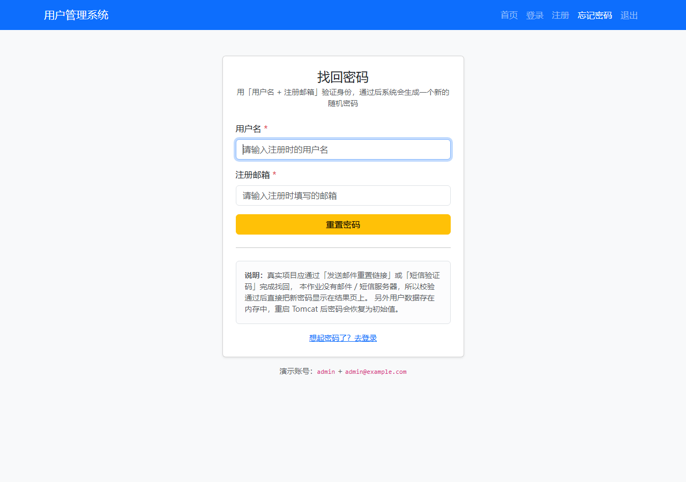
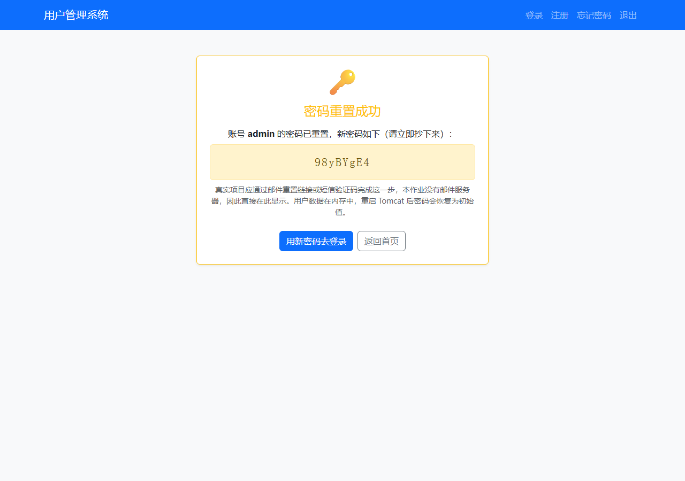
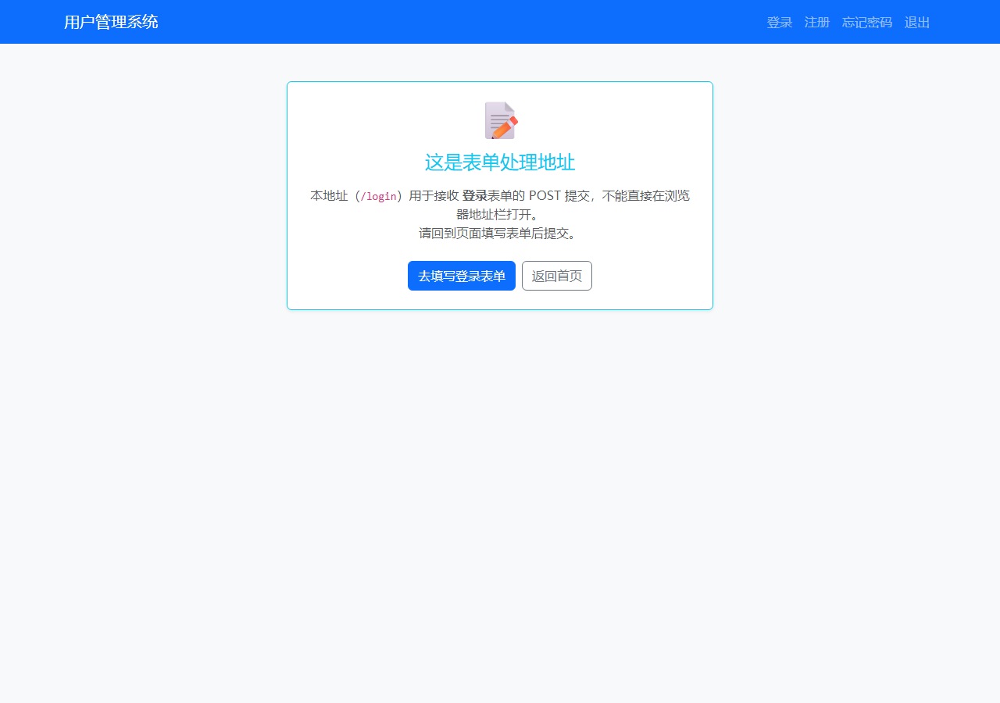

# 用户管理系统（JavaWeb 课程作业）蒲正艺

登录、注册、忘记密码三个前端页面 + 处理这三个页面的三个 Servlet，基于原生 Servlet 4.0（不依赖 Spring），可直接部署到 Tomcat 9 运行。

## 一、功能清单

| 功能 | 前端页面 | 处理 Servlet | 说明 |
|------|----------|--------------|------|
| 用户登录 | `login.html` | `LoginServlet` → `/login` | 校验账号密码，支持「记住我」（会话 7 天），登录态写入 session |
| 用户注册 | `register.html` | `RegisterServlet` → `/register` | 七项校验（必填 / 用户名 / 密码长度 / 两次一致 / 邮箱 / 手机号 / 查重） |
| 找回密码 | `forgot.html` | `ForgotPasswordServlet` → `/forgot` | 「用户名 + 注册邮箱」双重身份验证，通过后生成随机新密码 |
| 退出登录 | 导航栏「退出」 | `LogoutServlet` → `/logout` | 销毁 session，演示登录态清除 |
| 功能导航 | `index.html` | — | 三个功能的入口 + 预置测试账号 |

## 二、技术栈

- Java 17（`maven.compiler.release=17`，JDK 21 实测可用）
- Servlet 4.0（`javax.servlet-api 4.0.1`，scope = `provided`）
- Tomcat 9.0.121
- Maven 3.9（`packaging=war`）
- Bootstrap 5.3.3（**已下载到项目内**，`src/main/webapp/static/`，断网也能正常显示样式）

## 三、目录结构

```
javaweb-user/
├─ pom.xml                                  Maven 配置（war 打包）
├─ src/main/java/com/pzy/
│  ├─ web/LoginServlet.java                 登录处理
│  ├─ web/RegisterServlet.java              注册处理
│  ├─ web/ForgotPasswordServlet.java        忘记密码处理
│  ├─ web/LogoutServlet.java                退出登录
│  ├─ model/User.java                       用户实体
│  ├─ store/UserStore.java                  内存数据仓库（单例，模拟数据库）
│  └─ util/Pages.java                       页面渲染工具（HTML 骨架 / 结果卡片 / 转义）
├─ src/main/webapp/
│  ├─ index.html   login.html   register.html   forgot.html
│  ├─ static/css/bootstrap.min.css
│  ├─ static/js/bootstrap.bundle.min.js
│  └─ WEB-INF/web.xml                       欢迎页 + UTF-8 编码声明
└─ docs/screenshots/                        运行截图
```

## 四、运行方式

### 方式一：IDEA（推荐）

1. IDEA 打开 `javaweb-user` 目录（识别为 Maven 工程后自动下载依赖）；
2. `Run → Edit Configurations → + → Tomcat Server → Local`，Tomcat Home 选本机 Tomcat 9 安装目录；
3. `Deployment` 页签添加 `javaweb-user:war exploded`，Application context 填 `/javaweb-user`；
4. 启动后访问 <http://localhost:8080/javaweb-user/>。

### 方式二：命令行

```bash
mvn clean package
# 把 target/javaweb-user.war 拷进 Tomcat 的 webapps/，启动 Tomcat
cp target/javaweb-user.war $CATALINA_HOME/webapps/
```

访问 <http://localhost:8080/javaweb-user/>。

### 测试账号

| 用户名 | 密码 | 注册邮箱（找回密码用） |
|--------|------|------------------------|
| `admin` | `123456` | `admin@example.com` |

也可以先自己注册一个账号再登录。

## 五、运行截图

| 首页 | 登录页 |
|------|--------|
|  |  |

| 登录失败（服务端提示） | 登录成功 |
|------------------------|----------|
|  |  |

| 注册页 | 注册成功 |
|--------|----------|
|  |  |

| 注册失败（用户名重复） | 忘记密码页 |
|------------------------|------------|
|  |  |

| 密码重置成功（结果为随机密码） | 直接访问 Servlet 的提示 |
|--------------------------------|-------------------------|
|  |  |

## 六、设计要点

- **分层**：页面 → Servlet（控制）→ `UserStore`（数据）→ `User`（实体）→ `Pages`（视图工具）。换数据库只动 `UserStore`。
- **PRG 模式**：校验失败时用 `sendRedirect` 带 `?error=中文提示` 跳回页面，避免用户按 F5 重复提交表单。
- **两遍校验**：前端 `required` / `pattern` / `setCustomValidity` 只负责体验（不用等服务器往返），服务端那一份才是安全边界。
- **中文编码三处一起上**：`web.xml` 的 `request/response-character-encoding` + 每个 Servlet 的 `setCharacterEncoding("UTF-8")` + 响应 `setContentType("text/html;charset=UTF-8")`。
- **防 XSS**：所有回显用户输入的地方都过 `Pages.esc()` 做 HTML 转义；页面端用 `textContent` 而不是 `innerHTML` 渲染提示。真实姓名填 `<script>alert(1)</script>` 注册后，页面上显示的是转义后的纯文本。
- **忘记密码不泄露账号**：用户名不存在和邮箱不匹配统一提示「用户名与注册邮箱不匹配」，避免被人拿接口试探系统里有哪些账号。
- **并发安全**：注册入库用 `ConcurrentHashMap.putIfAbsent`（原子操作），而不是「先查重再 put」两步。
- **`getSession(false)`**：退出登录时不凭空创建新会话。

## 七、已知限制（作业范围内的简化）

1. 用户数据保存在**内存**（`UserStore` 的 `ConcurrentHashMap`），**重启 Tomcat 会清空**，这不是 bug；
2. 密码明文存储，真实项目必须加盐哈希（如 BCrypt）；
3. 找回密码直接把新密码显示在页面上——真实项目应发邮件重置链接或短信验证码，本作业没有邮件/短信服务器。

> 换成 MySQL：只需把 `UserStore` 的方法体改成 JDBC 实现（并在 `pom.xml` 加驱动依赖），三个 Servlet 与四个页面**一行都不用改**——这正是分层的价值。
